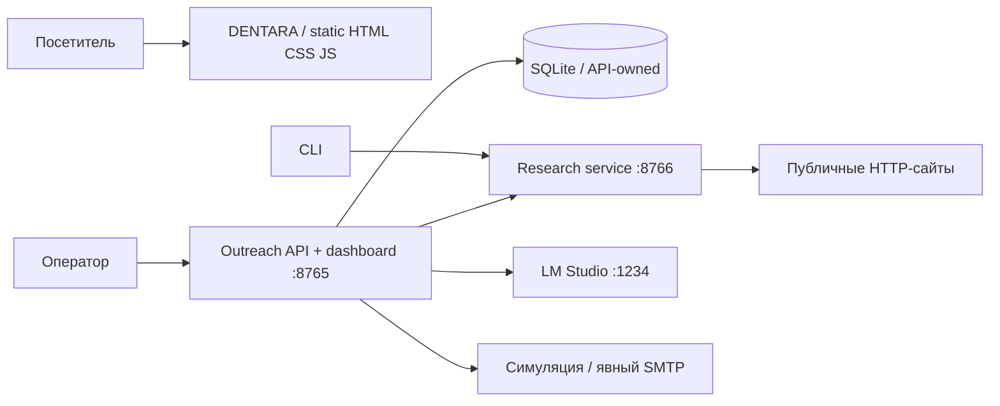

# Архитектура

## Границы ответственности

DENTARA и Outreach не обмениваются медицинскими или контактными данными. Демонстрационная форма работает только в браузере. Публичный статический сайт не должен обслуживаться из процесса внутреннего dashboard.

### Research

Отдельно запускаемый stateless-сервис владеет HTTP-исследованием страниц и извлечением детерминированных признаков. Он не импортирует `app.server`, не открывает SQLite, не вызывает модель и не отправляет письма. Вызов через HTTP имеет те же контракты evidence и contacts, что и локальный адаптер.

- `app/research/server.py`: endpoint-маршрутизация и ограничение параллельных исследований.
- `app/research/client.py`: межпроцессный транспорт, таймаут и проверка формы ответа.
- `app/research/network.py`: проверка публичного адреса перед HTTP-запросом и переходом по redirect.
- `app/website_audit.py`: детерминированный аудит и совместимый фасад `audit_website`.
- `app/extraction/public_page.py`: извлечение контактов и совместимый фасад `inspect_site`.

`RESEARCH_SERVICE_URL` выбирает способ исполнения. При пустом URL функции выполняются локально. При непустом URL приложение вызывает сервис; недоступность или неверный контракт дают `UNKNOWN` и пустой результат контактов с диагностикой. Утверждать отсутствие функции по ошибке транспорта нельзя.

### API и данные

`app/server.py` сохраняет существующие endpoints и оркестрацию пакетов. Настройки вынесены в `app/config.py`, общий JSON-транспорт — в `app/http_api.py`. API остаётся локальным оркестратором с одной базой: это сохраняет семантику review, резервирования отправки, suppression и восстановления после перезапуска.

На общей SQLite-connection методы `Database` сериализуются через `RLock`; вложенные операции разрешены. Прямые записи из worker обёрнуты тем же lock. WAL и `busy_timeout` помогают сосуществовать отдельным соединениям. Индексы соответствуют поиску компании, последним анализам/черновикам, контактам и истории адресатов. `list_clinics` агрегирует контакты и анализы отдельно и получает последний черновик одним SQL-запросом, без размножения строк и запроса на каждую компанию.

Внешний код, напрямую использующий `Database.conn` для записи, должен удерживать `Database.lock` на всей транзакции. Предпочтительно добавлять операции в `Database`, а не новые прямые записи.

Остаточная оркестрация пока не выделена в отдельные воркеры по сети. Для дальнейшего разделения понадобятся очередь с долговечными заданиями, идемпотентные команды и единственный владелец переходов отправки; разделять SQLite между независимыми отправителями нельзя без отдельного проекта транзакционных границ.

## Контракт HTTP research v1

По умолчанию: `127.0.0.1:8766`. Для non-loopback bind нужен `RESEARCH_SERVICE_TOKEN`; запросы используют `Authorization: Bearer <token>`. Health endpoint не требует токена. Клиент не следует перенаправлениям service URL, чтобы не передавать токен другому адресу.

| Метод и путь | Запрос | Ответ |
| --- | --- | --- |
| `GET /healthz` | — | `{"service":"research","version":1,"status":"ok"}` |
| `POST /v1/audit` | `{"url":"https://example.com","timeout":8}` | Аудит: `website_status`, `status`, `evidence`, признаки при успешном fetch |
| `POST /v1/inspect` | Такой же | `website`, `pages`, `contacts`, `errors`, `text` |

`url`: 1–4096 символов, HTTP(S), без встроенных credentials. Домен без схемы трактуется как HTTPS. `timeout`: целое число 1–15, по умолчанию 8 секунд на сетевой запрос. Inspection посещает до четырёх URL, сохраняя до трёх HTML-страниц; клиент ожидает до `4 × timeout + 5` секунд. Таймаут socket не является строгим общим deadline для всей операции.

Тело research ограничено 8 KiB; API — 1 MiB. Разрешён JSON-объект. Ошибки формата возвращаются JSON: `400`, слишком большое тело — `413`, неверный media type — `415`, чужой browser Origin — `403`, неверный service token — `401`. Более четырёх одновременных исследований получают `503`, без начала внешнего fetch. Это ограничение исследований, а не полноценный лимитер входящих HTTP-соединений.

Проверка адресов исключает приватные и специальные IP и проверяет redirect. Для недоверенных многопользовательских развёртываний потребуется отдельная egress-политика: DNS повторно разрешается стандартным HTTP-клиентом, поэтому эта проверка сама по себе не гарантирует защиту от DNS rebinding. Dashboard предназначен для локального доступа и не получил публичную аутентификацию.

## Запуск и развертывание

1. Для обычной локальной работы: `python -m app.server`; без service URL research выполняется в процессе.
2. Для разделённых процессов: `python -m app.research.server`, затем API с `RESEARCH_SERVICE_URL=http://127.0.0.1:8766`.
3. Для контейнера research: корневые `Dockerfile.research` и `compose.yaml`. Контейнер запускается непривилегированным пользователем, с read-only filesystem и публикацией порта только на loopback хоста. Укажите токен через окружение; он не включается в образ.

Research можно обновлять отдельно от API, пока сохраняется `/v1`-контракт. Health сервиса проверяет процесс HTTP, а не доступность каждого публичного источника.
